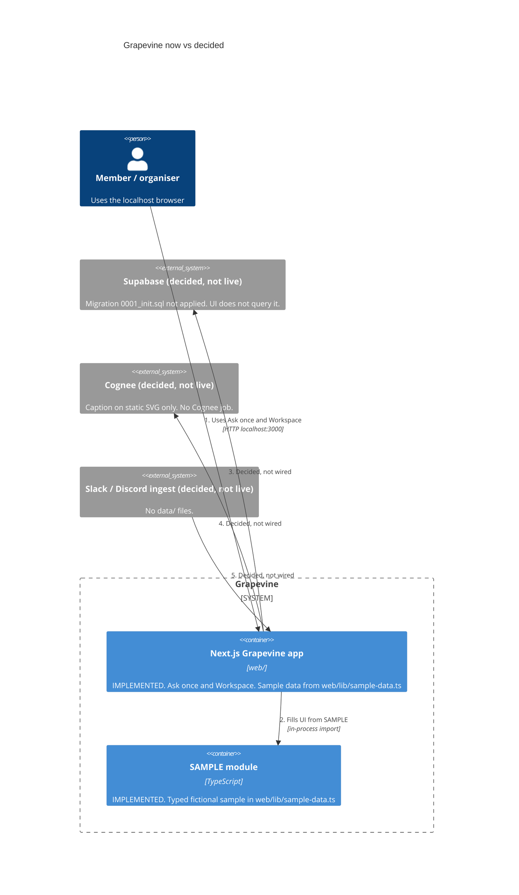

# Built with

Grapevine was planned with **Grok Bot**, which holds the context, and built with **Cursor**, which ships the code. **Supabase** and **Cognee** are decided sponsors: the schema and a labelled sample graph are in the repo; they are not live services yet. Commits are tagged `[grok-bot]`, `[cursor]` or `[mani]`, with trailer lines `Context-by:` and `Built-with:`. Every action is also logged in [`PROGRESS.md`](../PROGRESS.md).

## Shape now vs decided

Live path is the localhost Next.js app in `web/`, filled from typed `SAMPLE` in `web/lib/sample-data.ts`. Supabase, Cognee, and Slack/Discord ingest are decided and not wired.

## Grok Bot (SpaceXAI): the context holder
| What Grok Bot did | Where to see it |
|---|---|
| Ran the planning interview with Mani: one question at a time, each with a fallback answer, alternatives and a recommendation, while Mani made the calls | `docs/planning/01`–`06`; every decision is in [`decisions.md`](planning/decisions.md) with its time, who decided and why |
| Re-read the event page and matched each judging criterion to the product | [`docs/planning/00-event.md`](planning/00-event.md) |
| Designed and rendered the one-screen UI mockups (13 screens at 1280 and 390, light and dark) | `mockup/grapevine.html`, `mockup/screens/`, `mockup/contact-sheet.png` |
| Set up the repo: git, `.gitignore` with secrets ignored, `.env.example`, a private GitHub remote | the `[grok-bot]` commits |
| Wrote the build prompts that Cursor's agent runs | `.cursor-runs/` (local only) and [`docs/planning/HANDOFF.md`](planning/HANDOFF.md) |

**Decided, not in the repo yet:** a read-only community ingest (`data/rules.jsonl`, `data/channel-selection.json`, `data/coverage.jsonl`) and an in-app **Read next** routine. Growth shows an inert Read next button; those data files do not exist.

How to check: `git log --oneline --grep '\[grok-bot\]'` and `grep '\[grok-bot\]' PROGRESS.md`.

## Cursor: the builder
Cursor's local agent ships the app on the Mac from the prompts above, following the planning docs and the rules in the repo. Step 1 is on `main` (merged from `feat/step1-scaffold` and `feat/ask-once-name`). How to check: `git log --oneline --grep '\[cursor\]'` and the `[cursor-agent-0]` lines in `PROGRESS.md`.

| What Cursor does | Where to see it |
|---|---|
| Next.js (App Router) + TypeScript + Tailwind + shadcn/ui app | `web/` |
| Tagged commits from the local agent | `[cursor]` subjects and `Built-with: Cursor` trailers |
| Design tokens (light default; dark opt-in via `.dark`) | `kit/design/tokens.css`, ported into `web/app/tokens.css` |
| Ask once (graph, known answer, where to post) and Workspace (Ask/Announce, side menu) | `web/`, filled from `web/lib/sample-data.ts` |
| Drafted Supabase schema + `route_question()` | `supabase/migrations/0001_init.sql` (not applied) |

## Supabase: the store and search
**Decided:** Postgres with keyword plus meaning search (pgvector) combined in one `route_question()` hybrid RRF function, and live updates that drive the coverage view.

| What is in the repo | Where to see it |
|---|---|
| Initial schema: channels, people, messages (generated `fts` tsvector + GIN, `embedding vector(384)`), rules, coverage, graph_nodes, graph_edges, my_posts | `supabase/migrations/0001_init.sql` |
| Hybrid keyword + meaning search (SQL only) | `route_question(query_text, query_embedding)` in that migration |

The Step 1 migration is **not applied**: Supabase keys in `.env.local` are still empty (see `.env.example`). The UI does not call the database; `web/lib/env.ts` can read keys but nothing uses them yet. Env is read only via `process.env`. Do not commit `.env.local`.

## Cognee: the knowledge graph
**Decided:** build the people, topics, channels and threads graph locally on the Mac; the Experts graph view reads it.

**In the app now:** a static SVG in `web/components/knowledge-graph.tsx`, labelled "Graph by Cognee." There is no Cognee package or local graph job.

## Zero (stretch)
Only used if the CRM stretch goal is built.
| Grok Bot | Live Slack + Discord read (read-only, CDP), Supabase load + embeddings, Cognee Cloud (hosted, sponsor) add/cognify/graph via X-Api-Key | reader/live/ (PR feat/community-read) |
