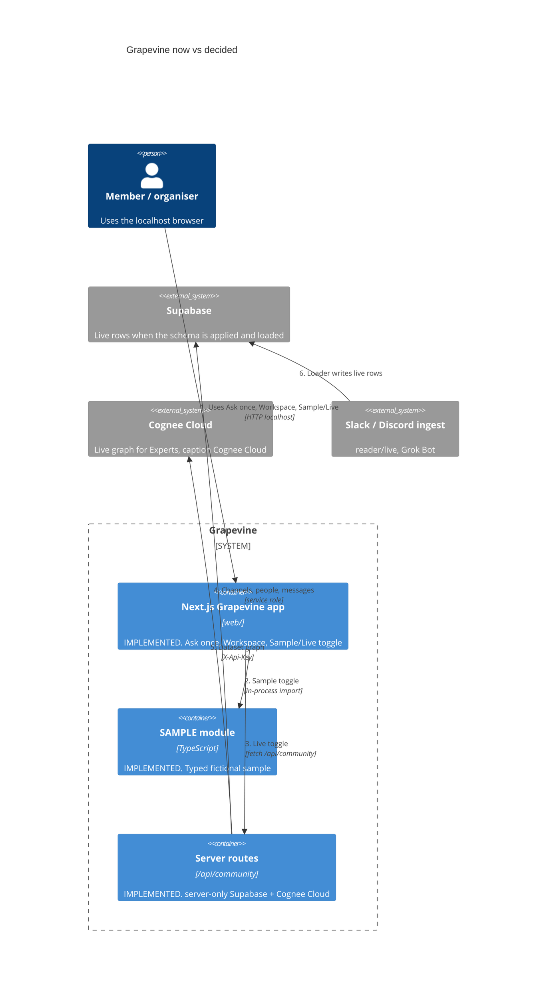

# Built with

Grapevine was planned with **Grok Bot**, which holds the context, and built with **Cursor**, which ships the code. **Supabase** and **Cognee Cloud** are wired behind the header Sample/Live toggle. Commits are tagged `[grok-bot]`, `[cursor]` or `[mani]`, with trailer lines `Context-by:` and `Built-with:`. Every action is also logged in [`PROGRESS.md`](../PROGRESS.md).

## Shape now vs decided

Live path is the localhost Next.js app in `web/`. Sample fills from `web/lib/sample-data.ts`. Live reads Supabase and Cognee Cloud through `/api/community` when the header toggle is Live.

## Grok Bot (SpaceXAI): the context holder
| What Grok Bot did | Where to see it |
|---|---|
| Ran the planning interview with Mani: one question at a time, each with a fallback answer, alternatives and a recommendation, while Mani made the calls | `docs/planning/01`–`06`; every decision is in [`decisions.md`](planning/decisions.md) with its time, who decided and why |
| Re-read the event page and matched each judging criterion to the product | [`docs/planning/00-event.md`](planning/00-event.md) |
| Designed and rendered the one-screen UI mockups (13 screens at 1280 and 390, light and dark) | `mockup/grapevine.html`, `mockup/screens/`, `mockup/contact-sheet.png` |
| Set up the repo: git, `.gitignore` with secrets ignored, `.env.example`, a private GitHub remote | the `[grok-bot]` commits |
| Wrote the build prompts that Cursor's agent runs | `.cursor-runs/` (local only) and [`docs/planning/HANDOFF.md`](planning/HANDOFF.md) |

**Decided, not in the repo yet:** a read-only community ingest (`data/rules.jsonl`, `data/channel-selection.json`, `data/coverage.jsonl`) and an in-app **Read next** routine. Growth shows an inert Read next button; those data files do not exist.

How to check: `git log --oneline --grep '\[grok-bot\]'` and `grep '\[grok-bot\]' PROGRESS.md`.

## Cursor: the builder
Cursor's local agent ships the app on the Mac from the prompts above, following the planning docs and the rules in the repo. Step 1 is on `main` (merged from `feat/step1-scaffold` and `feat/ask-once-name`). How to check: `git log --oneline --grep '\[cursor\]'` and the `[cursor-agent-0]` lines in `PROGRESS.md`.

| What Cursor does | Where to see it |
|---|---|
| Next.js (App Router) + TypeScript + Tailwind + shadcn/ui app | `web/` |
| Tagged commits from the local agent | `[cursor]` subjects and `Built-with: Cursor` trailers |
| Design tokens (light default; dark opt-in via `.dark`) | `kit/design/tokens.css`, ported into `web/app/tokens.css` |
| Ask once, Workspace, Sample/Live toggle | `web/`. Sample from `web/lib/sample-data.ts`; Live from `/api/community` |
| Drafted Supabase schema + `route_question()` | `supabase/migrations/0001_init.sql` |
| Live-mode fixes ([PR #11](https://github.com/neomatrix369/grapevine/pull/11)) | Empty Ask box + suggestions; `/api/ask` ranks matches; no "unknown" experts; message counts when threads are 0; channel names not guild ids; source label from `channels.platform`; Cognee graph filtered to people/topics; copy/open/Play demo wired; honest empty/unreachable states |

## Supabase: the store and search
**Decided 21:38 (Mani):** Supabase holds the **live** Slack and Discord messages read by Grok Bot (two weeks, public channels). The app reads Supabase; sample data is only a labelled fallback when it is empty.

**Decided:** Postgres with keyword plus meaning search (pgvector) combined in one `route_question()` hybrid RRF function, and live updates that drive the coverage view.

| What is in the repo | Where to see it |
|---|---|
| Initial schema: channels, people, messages (generated `fts` tsvector + GIN, `embedding vector(384)`), rules, coverage, graph_nodes, graph_edges, my_posts | `supabase/migrations/0001_init.sql` |
| Hybrid keyword + meaning search (SQL only) | `route_question(query_text, query_embedding)` in that migration |

`.env.example` lists the Supabase, Cognee Cloud, and `LLM_API_KEY` names; copy it to `.env.local` at the repo root and never commit that file. Live mode uses `SUPABASE_SERVICE_ROLE_KEY` only in `server-only` modules. Env is read only via `process.env`.

## Cognee Cloud: the knowledge graph
**Decided 21:43 (Mani):** Cognee **Cloud** (hosted), replacing the earlier local Cognee 1.6.5 plan. The ingest on `feat/community-read` adds the live messages to the Cognee Cloud dataset `grapevine` (`POST /api/v1/add`, then `POST /api/v1/cognify`). The app reads the graph and graph search server-side (`POST /api/v1/search`, dataset graph endpoint) with `X-Api-Key` from `COGNEE_API_KEY`. Build brief: `docs/planning/07-live-data-build.md`.

**In the app now:** `web/components/knowledge-graph.tsx` draws Cognee Cloud / Supabase nodes when Live is selected, and the sample people layout when Sample is selected. Caption on Live is "Knowledge graph by Cognee Cloud".

## Zero (stretch)
Only used if the CRM stretch goal is built.
| Grok Bot | Live Slack + Discord read (read-only, CDP), Supabase load + embeddings, Cognee Cloud (hosted, sponsor) add/cognify/graph via X-Api-Key | reader/live/ (PR feat/community-read) |
